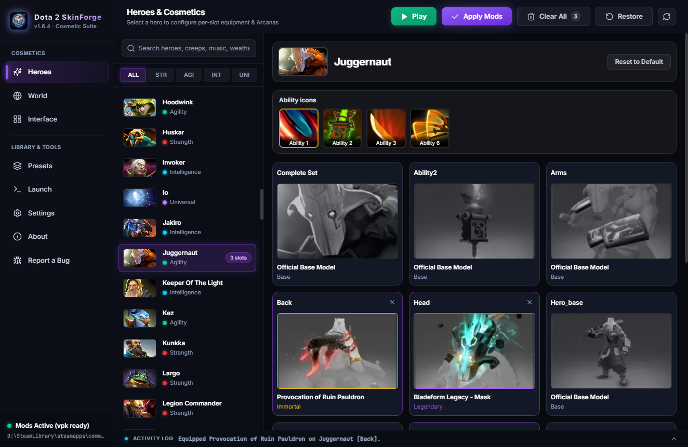
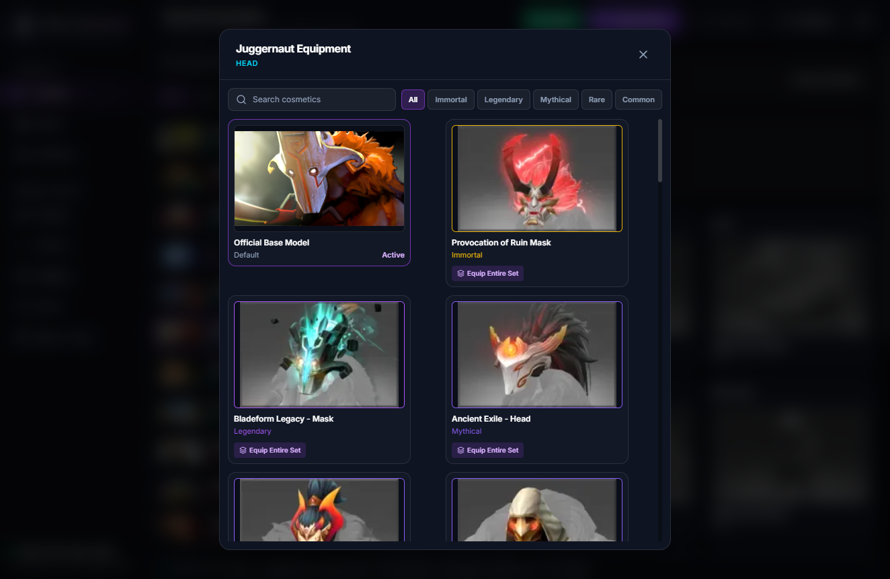
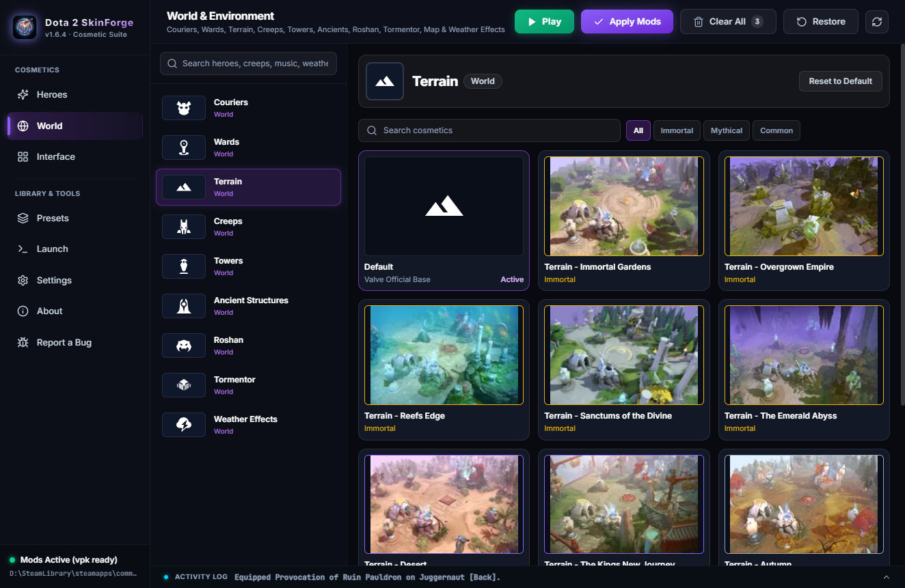
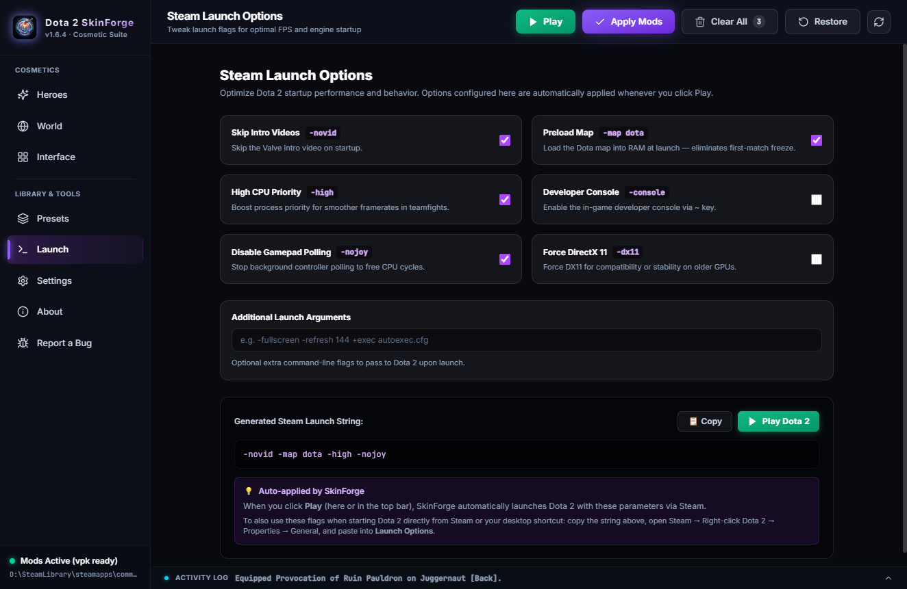

<div align="center">
  
  <h1>Dota 2 SkinForge</h1>
  <p><strong>Free, open-source Dota 2 skin changer &amp; cosmetic loader — no DLL injection, no memory writes.</strong></p>

  <p>
    <a href="https://github.com/javadag/dota2-skinforge/releases/latest"></a>
    <a href="https://github.com/javadag/dota2-skinforge/releases"></a>
    <a href="https://github.com/javadag/dota2-skinforge/stargazers"></a>
    <a href="https://www.microsoft.com/windows"></a>
    <a href="LICENSE"></a>
  </p>

  <p>
    <a href="https://github.com/javadag/dota2-skinforge/releases/latest">
      
    </a>
  </p>

  <p>
    <a href="#quick-start">Quick Start</a> •
    <a href="#features">Features</a> •
    <a href="#screenshots">Screenshots</a> •
    <a href="#faq">FAQ</a> •
    <a href="#for-developers">Build from Source</a>
  </p>
</div>

**Dota 2 SkinForge** is a free, open-source Windows desktop app that lets you equip official Dota 2 cosmetics — **Arcanas, Immortals, Personas, Complete Sets, Styles, Terrains, Weather, Couriers, Wards, Creeps, Towers, Music Packs, Announcers, HUDs, and Ability Icons** — locally and client-side using Valve's native Source 2 VPK asset-mounting system.

> **Use at Your Own Risk** — Read the [Disclaimer](#disclaimer) below before using.

<p align="center">
  
</p>

---

## Quick Start

1. **Download** the latest release from **[GitHub Releases](https://github.com/javadag/dota2-skinforge/releases/latest)**:
   - **`Dota2SkinForge-Portable.exe`** — Single-file portable app (no installation required)
   - **`Dota2SkinForge-Setup-vX.X.X.exe`** — Standard Windows installer
2. **Pick your cosmetics** across **Heroes**, **World**, and **Interface** (individual slots, styles, Personas, or one-click full sets).
3. **Click `Apply Mods`**, then launch Dota 2 with **`Play`** (make sure Dota 2 is closed while applying or restoring).

Want to go back to stock? Click **`Restore`** in the top bar at any time for a clean 1-click revert.

---

## Features

| Feature                     | Description                                                                                     |
| --------------------------- | ----------------------------------------------------------------------------------------------- |
| **Per-Slot & Set Armory**   | Equip Arcanas, Immortals, Personas, styles, and full sets per hero, plus World & Interface gear |
| **Reconnect-Safe Models**   | Merges and routes empty-slot wearables so cosmetics stay visible after match disconnects        |
| **Custom Ability Icons**    | Override any hero's ability icons directly from Valve's spell icon library                      |
| **Preset Manager**          | Save full multi-hero loadouts and switch between them in one click                              |
| **Auto Patch Recovery**     | Detects when Dota 2 updates reset `gameinfo_branchspecific.gi` and prompts a quick re-apply     |
| **Launch Options Builder**  | Toggle Steam launch flags (`-novid`, `-map dota`, `-high`, `-nojoy`, `-dx11`, etc.)             |
| **Zero Memory Injection**   | Uses Valve's native VPK search-path loader — no DLL hooking or `dota2.exe` memory writes        |
| **1-Click Restore & Audit** | Revert to vanilla unmodded Dota 2 anytime; 100% open-source TypeScript & Electron               |

---

## Screenshots

<table>
  <tr>
    <td width="50%" valign="top">
      <p align="center"><strong>Cosmetic Picker &amp; One-Click Sets</strong></p>
      
    </td>
    <td width="50%" valign="top">
      <p align="center"><strong>World &amp; Environment Cosmetics</strong></p>
      
    </td>
  </tr>
  <tr>
    <td colspan="2" valign="top">
      <p align="center"><strong>Steam Launch Options Builder</strong></p>
      <p align="center">
        
      </p>
    </td>
  </tr>
</table>

---

## How It Works

1. **Reads Valve's stock `items_game.txt`** directly from your local Dota 2 VPK.
2. **Compiles your selected loadouts** into a validated `items_game.txt` and packages any required models, overlays, and reconnect merges into `pak01_dir.vpk` + `pak01_000.vpk`.
3. **Mounts the mod folder** in `gameinfo_branchspecific.gi` and updates `dota.signatures` so Source 2 loads your overrides cleanly.

---

## FAQ

<details>
<summary><strong>Can other players see my cosmetics?</strong></summary>

No. All changes are **client-side only** — only you see the equipped cosmetics on your screen.

</details>

<details>
<summary><strong>Does SkinForge inject DLLs or modify Dota 2 memory?</strong></summary>

No. SkinForge never hooks `dota2.exe`, never injects DLLs, and refuses to modify game files while Dota 2 is running. It only builds a local Source 2 VPK pack and mounts it via `gameinfo_branchspecific.gi`. Still, modifying local game files is always **use at your own risk** (see [Disclaimer](#disclaimer)).

</details>

<details>
<summary><strong>What happens when Dota 2 receives a patch?</strong></summary>

Dota 2 updates can overwrite `gameinfo_branchspecific.gi` and `items_game.txt`. SkinForge automatically detects when a patch resets your setup and lets you re-apply your saved loadout cleanly against the fresh game schema in one click.

</details>

<details>
<summary><strong>Do cosmetics disappear if I disconnect and reconnect to a match?</strong></summary>

SkinForge delivers slot models by overwriting Valve's precached stock model paths and includes an automated wearable-merger pipeline for empty default slots, keeping Arcanas, Personas, and set pieces visible across match reconnects.

</details>

<details>
<summary><strong>Why does Windows SmartScreen show a warning on first launch?</strong></summary>

Windows SmartScreen warns on unsigned open-source `.exe` files that haven't purchased a paid EV code-signing certificate. SkinForge is 100% open-source — you can inspect every line of code or build the executable yourself from source below.

</details>

---

## For Developers

<details>
<summary><strong>Build from Source</strong></summary>

Prerequisites:

- Windows 10 / 11
- [Node.js](https://nodejs.org/) >= 18
- [.NET 10 SDK](https://dotnet.microsoft.com/download) (required for `npm run build:win` / `build:wearable-merger`)
- Dota 2 installed via Steam

```powershell
git clone https://github.com/javadag/dota2-skinforge.git
cd dota2-skinforge
npm install

# Run in development mode (HMR)
npm run dev

# Build and preview locally
npm run build
npm start

# Build a portable Windows executable
npm run build:win
```

</details>

<details>
<summary><strong>Project Structure</strong></summary>

```text
dota2-skinforge/
├── assets/                   # App icons, category SVGs, hero portraits, icon packs, reconnect catalogs
├── data/                     # Armory catalogs, item styles, overlay & package manifests
├── docs/                     # Architecture, development, cosmetic guides, and README screenshots
├── scripts/                  # Catalog, icon pack, asset sync, and smoke-test CLI scripts
├── test/                     # Unit & data-integrity test suites (node:test via tsx)
├── tools/wearable-merger/    # .NET 10 AOT tool for apply-time .vmdl_c reconnect merging
├── workers/bug-report/       # Cloudflare Worker relay for in-app bug reports
└── src/
    ├── main/                 # Electron main process (IPC + services: app, dota, assets, modifier, pipeline)
    ├── preload/              # Context-isolated IPC bridge (`window.skinforge`)
    ├── renderer/             # React 19 + Tailwind CSS v4 UI (views, modals, components, state, utils)
    └── shared/               # Pure domain types, armory catalog logic, constants, and shared utils
```

</details>

### Documentation

- **[Architecture Overview](docs/ARCHITECTURE.md)** — System diagram, folder map, and the Apply/Restore pipeline
- **[Development Guide](docs/DEVELOPMENT.md)** — Setup, scripts, adding features, fixing bugs, and coding conventions
- **[Cosmetics & Reconnect Guide](docs/COSMETICS_AND_RECONNECT.md)** — Adding heroes/Arcanas, reconnect merges, and asset cleanup
- **[Release Guide](RELEASE_GUIDE.md)** — Asset uploads, version pinning, and pushing release tags
- **[AI Agent Guidelines](AGENTS.md)** — Navigation rules and invariants for coding assistants

---

## Disclaimer

> **USE AT YOUR OWN RISK.**
>
> Dota 2 SkinForge modifies local game files (`gameinfo_branchspecific.gi`, `dota.signatures`, and a local VPK folder) on your machine. While it uses only Valve's native asset loading pipeline and does **not** inject code or memory into `dota2.exe`, **the author makes no guarantees regarding Valve's Terms of Service, VAC status, or future game updates.**
>
> - Cosmetic changes are **client-side only** — other players cannot see your overrides.
> - Always use **Restore** before uninstalling or verifying game files in Steam.
> - Not affiliated with or endorsed by Valve Corporation.

---

## License

MIT © Joad
