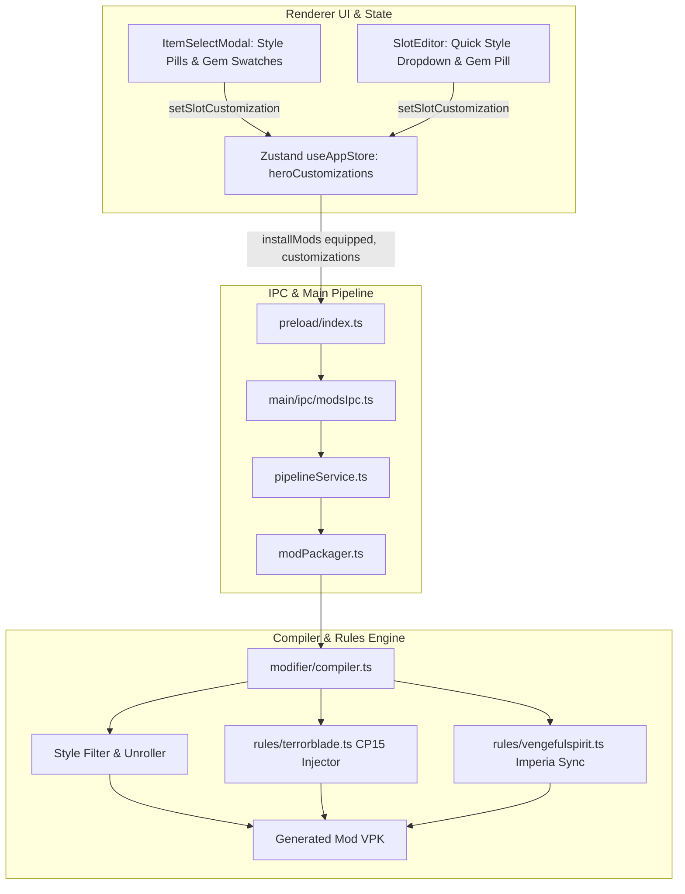

# Arcana Styles & Prismatic Gems Implementation Plan

> **For agentic workers:** REQUIRED SUB-SKILL: Use superpowers:subagent-driven-development to implement this plan task-by-task. Steps use checkbox (`- [ ]`) syntax for tracking.

**Goal:** Enable players to unlock all alternate Arcana styles (e.g. Vengeful Spirit Queen Imperia, QoP Royal Decree, WK Malignant Monster) and customize Prismatic Gem flame colors (e.g. Terrorblade Arcana with Creator's Light, Rubiline, Midas Gold, or custom RGB) in SkinForge.

**Architecture:** A non-breaking parallel customization map (`heroCustomizations`) tracks per-slot style and gem settings in the Zustand store. IPC passes this map to the main process compiler, which unrolls style-conditioned asset modifiers into unconditional ones, overrides root models and skins, and injects Control Point 15 particle RGB vectors for Terrorblade Arcana.

**Architecture Diagram:**



**Tech Stack:** TypeScript, React, Zustand, Electron IPC, Node.js `child_process`, KeyValues/VDF items_game schema parser, Source 2 VPK engine.

**Spec:** [`docs/superpowers/specs/2026-10-11-arcana-styles-and-prismatic-gems-design.md`](file:///e:/My/dota2-skinforge/docs/superpowers/specs/2026-10-11-arcana-styles-and-prismatic-gems-design.md)

## Global Constraints

- Preserve 100% backward compatibility for `heroSlots: Record<string, Record<string, string>>` across presets and existing tests.
- Zero placeholder code; include full implementations and test assertions in every step.
- All tests must run via `tsx test/<name>.test.js` and exit with code 0.
- All TypeScript types must pass `npm run typecheck` (`tsc -b --noEmit`) without errors.

---

### Task 1: Customization Types & Prismatic Gems Constants

**Files:**

- Create: `src/shared/types/customization.ts`
- Create: `src/shared/constants/prismaticGems.ts`
- Test: `test/prismaticGems.test.js`

**Interfaces:**

- Produces: `ItemCustomization`, `HeroCustomizationsMap`, `PRISMATIC_GEMS`, `hexToRgb()`, `getGemByHex()`

- [ ] **Step 1: Write the failing test**

Create `test/prismaticGems.test.js`:

```javascript
const assert = require('assert')
const { PRISMATIC_GEMS, hexToRgb, getGemByHex } = require('../src/shared/constants/prismaticGems')

// Verify palette completeness
assert.ok(Array.isArray(PRISMATIC_GEMS), 'PRISMATIC_GEMS should be an array')
assert.strictEqual(PRISMATIC_GEMS.length, 42, 'Should include all 42 Valve prismatic gems')

// Test hexToRgb conversion
assert.strictEqual(hexToRgb('#D11FA1'), '209 31 161', 'Rubiline RGB should be 209 31 161')
assert.strictEqual(hexToRgb('#DCF2FF'), '220 242 255', "Creator's Light RGB should be 220 242 255")
assert.strictEqual(hexToRgb('#060606'), '6 6 6', 'Cursed Black RGB should be 6 6 6')

// Test getGemByHex lookup
const rubiline = getGemByHex('#D11FA1')
assert.ok(rubiline, 'Rubiline lookup should find gem')
assert.strictEqual(rubiline.name, 'Rubiline')

console.log('✔ Task 1 Prismatic Gems tests passed')
```

- [ ] **Step 2: Run test to verify it fails**

Run: `node --import tsx test/prismaticGems.test.js`
Expected: FAIL with "Cannot find module"

- [ ] **Step 3: Write types and implementation**

Create `src/shared/types/customization.ts`:

```typescript
export interface ItemCustomization {
  style?: number
  gemColor?: string
  gemName?: string
}

export type HeroCustomizationsMap = Record<string, Record<string, ItemCustomization>>
```

Create `src/shared/constants/prismaticGems.ts`:

```typescript
export interface PrismaticGem {
  id: string
  name: string
  hex: string
  rgb: [number, number, number]
  colorName: string
  isDefault?: boolean
}

export function hexToRgb(hex: string): string {
  const clean = hex.replace('#', '').trim()
  if (clean.length !== 6) return '255 255 255'
  const r = parseInt(clean.substring(0, 2), 16) || 0
  const g = parseInt(clean.substring(2, 4), 16) || 0
  const b = parseInt(clean.substring(4, 6), 16) || 0
  return `${r} ${g} ${b}`
}

export const PRISMATIC_GEMS: PrismaticGem[] = [
  { id: 'unusual_red', name: 'Red', hex: '#D03D33', rgb: [208, 61, 51], colorName: 'UnusualRed' },
  { id: 'unusual_rubiline', name: 'Rubiline', hex: '#D11FA1', rgb: [209, 31, 161], colorName: 'UnusualRubiline' },
  { id: 'unusual_gold', name: 'Gold', hex: '#CFAB31', rgb: [207, 171, 49], colorName: 'UnusualGold' },
  { id: 'unusual_blue', name: 'Blue', hex: '#0097CE', rgb: [0, 151, 206], colorName: 'UnusualBlue' },
  { id: 'unusual_purple', name: 'Purple', hex: '#8232CF', rgb: [130, 50, 207], colorName: 'UnusualPurple' },
  { id: 'unusual_orange', name: 'Orange', hex: '#D07733', rgb: [208, 119, 51], colorName: 'UnusualOrange' },
  { id: 'unusual_light_green', name: 'Light Green', hex: '#B7CF33', rgb: [183, 207, 51], colorName: 'UnusualLightGreen' },
  { id: 'unusual_deep_blue', name: 'Deep Blue', hex: '#3D68C4', rgb: [61, 104, 196], colorName: 'UnusualDeepBlue' },
  { id: 'unusual_sea_green', name: 'Sea Green', hex: '#4AB78D', rgb: [74, 183, 141], colorName: 'UnusualSeaGreen' },
  { id: 'unusual_verdant_green', name: 'Verdant Green', hex: '#51B350', rgb: [81, 179, 80], colorName: 'UnusualVerdantGreen' },
  { id: 'unusual_deep_green', name: 'Deep Green', hex: '#37864D', rgb: [55, 134, 77], colorName: 'UnusualDeepGreen' },
  { id: 'unusual_bright_purple', name: 'Bright Purple', hex: '#8232ED', rgb: [130, 50, 237], colorName: 'UnusualBrightPurple' },
  { id: 'unusual_bright_green', name: 'Bright Green', hex: '#A1FF59', rgb: [161, 255, 89], colorName: 'UnusualBrightGreen' },
  { id: 'unusual_placid_blue', name: 'Placid Blue', hex: '#94CAD0', rgb: [148, 202, 208], colorName: 'UnusualPlacidBlue' },
  { id: 'unusual_summer_warmth', name: 'Summer Warmth', hex: '#FFEEBC', rgb: [255, 238, 188], colorName: 'UnusualSummerWarmth' },
  { id: 'unusual_defensive_red', name: 'Defensive Red', hex: '#FF4200', rgb: [255, 66, 0], colorName: 'UnusualDefensiveRed' },
  { id: 'unusual_creators_light', name: "Creator's Light", hex: '#DCF2FF', rgb: [220, 242, 255], colorName: 'UnusualCreatorsLight' },
  { id: 'unusual_blossom_red', name: 'Blossom Red', hex: '#D76092', rgb: [215, 96, 146], colorName: 'UnusualBlossomRed' },
  { id: 'unusual_crystalline_blue', name: 'Crystalline Blue', hex: '#1A3D85', rgb: [26, 61, 133], colorName: 'UnusualCrystallineBlue' },
  { id: 'unusual_cursed_black', name: 'Cursed Black', hex: '#060606', rgb: [6, 6, 6], colorName: 'UnusualCursedBlack' },
  { id: 'unusual_plague_grey', name: 'Plague Grey', hex: '#626E5B', rgb: [98, 110, 91], colorName: 'UnusualPlagueGrey' },
  {
    id: 'unusual_international_2012',
    name: 'Champion’s Blue (TI2)',
    hex: '#507DFE',
    rgb: [80, 125, 254],
    colorName: 'UnusualInternational2012'
  },
  {
    id: 'unusual_international_2013',
    name: 'Champion’s Green (TI3)',
    hex: '#15A515',
    rgb: [21, 165, 21],
    colorName: 'UnusualInternational2013'
  },
  { id: 'unusual_midas_gold', name: 'Midas Gold', hex: '#FFCA15', rgb: [255, 202, 21], colorName: 'UnusualMidasGold' },
  { id: 'unusual_earth_green', name: 'Earth Green', hex: '#5AC355', rgb: [90, 195, 85], colorName: 'UnusualEarthGreen' },
  { id: 'unusual_ember_flame', name: 'Ember Flame', hex: '#FFC604', rgb: [255, 198, 4], colorName: 'UnusualEmberFlame' },
  { id: 'unusual_diretide_orange', name: 'Diretide Orange', hex: '#F79D00', rgb: [247, 157, 0], colorName: 'UnusualDiretideOrange' },
  { id: 'unusual_dredge_earth', name: 'Dredge Earth', hex: '#BDB76B', rgb: [189, 183, 107], colorName: 'UnusualDredgeEarth' },
  { id: 'unusual_dungeon_doom', name: 'Dungeon Doom', hex: '#7B68EE', rgb: [123, 104, 238], colorName: 'UnusualDungeonDoom' },
  { id: 'unusual_manns_mint', name: "Mann's Mint", hex: '#BCDDB3', rgb: [188, 221, 179], colorName: 'UnusualMannsMint' },
  { id: 'unusual_business_pants', name: 'Business Pants', hex: '#F0E68C', rgb: [240, 230, 140], colorName: 'UnusualBusinessPants' },
  { id: 'unusual_unhallowed_ground', name: 'Unhallowed Ground', hex: '#808000', rgb: [128, 128, 0], colorName: 'UnusualUnhallowedGround' },
  { id: 'unusual_ship', name: 'Ships in the Night', hex: '#191970', rgb: [25, 25, 112], colorName: 'UnusualShips' },
  { id: 'unusual_miasma', name: 'Miasma', hex: '#C0C0C0', rgb: [192, 192, 192], colorName: 'UnusualMiasma' },
  {
    id: 'unusual_pristine_platinum',
    name: 'Pristine Platinum',
    hex: '#D5E3F5',
    rgb: [213, 227, 245],
    colorName: 'UnusualPristinePlatinum'
  },
  { id: 'unusual_vermilion_renewal', name: 'Vermilion Renewal', hex: '#CA0123', rgb: [202, 1, 35], colorName: 'UnusualVermilionRenewal' },
  {
    id: 'unusual_terrorblade_abysm',
    name: "Reflection's Shade (Default)",
    hex: '#FF3C28',
    rgb: [255, 60, 40],
    colorName: 'UnusualAbysm',
    isDefault: true
  },
  { id: 'unusual_lava_roshan', name: 'Lava Flame', hex: '#FF7832', rgb: [255, 120, 50], colorName: 'UnusualLavaRoshan' },
  { id: 'unusual_ice_roshan', name: 'Frost Glacier', hex: '#32ABDC', rgb: [50, 171, 220], colorName: 'UnusualIceRoshan' },
  { id: 'unusual_plush_shagbark', name: 'Plush Shagbark Pink', hex: '#FFC1DC', rgb: [255, 193, 220], colorName: 'UnusualPlushShagbark' },
  {
    id: 'unusual_international_courier_2014',
    name: 'Champion’s Purple (TI4)',
    hex: '#7F48C3',
    rgb: [127, 72, 195],
    colorName: 'UnusualInternational2014'
  },
  { id: 'unusual_techies_swine', name: 'Explosive Gold (Techies)', hex: '#FFAF00', rgb: [255, 175, 0], colorName: 'UnusualSwine' }
]

export function getGemByHex(hex: string): PrismaticGem | undefined {
  const norm = hex.toLowerCase().trim()
  return PRISMATIC_GEMS.find((g) => g.hex.toLowerCase() === norm)
}
```

- [ ] **Step 4: Run test to verify it passes**

Run: `node --import tsx test/prismaticGems.test.js`
Expected: PASS with "✔ Task 1 Prismatic Gems tests passed"

- [ ] **Step 5: Commit**

```bash
git add src/shared/types/customization.ts src/shared/constants/prismaticGems.ts test/prismaticGems.test.js
git commit -m "feat(types): add customization types and 42 official Prismatic Gems constants"
```

---

### Task 2: Arcana Styles Registry & Customization Helper

**Files:**

- Create: `src/shared/constants/arcanaStyles.ts`
- Test: `test/arcanaStylesRegistry.test.js`

**Interfaces:**

- Produces: `ARCANA_STYLES_MAP`, `getCosmeticCustomizationInfo(heroTag, slotId, itemName)`

- [ ] **Step 1: Write the failing test**

Create `test/arcanaStylesRegistry.test.js`:

```javascript
const assert = require('assert')
const { getCosmeticCustomizationInfo } = require('../src/shared/constants/arcanaStyles')

// Vengeful Spirit Arcana check
const vsInfo = getCosmeticCustomizationInfo('vengeful spirit', 'shoulder', 'The Resurrection of Shen - Wings')
assert.ok(vsInfo, 'VS Wings should have customization info')
assert.strictEqual(vsInfo.hasStyles, true)
assert.strictEqual(vsInfo.styles.length, 3)
assert.strictEqual(vsInfo.styles[2].name, 'Queen Imperia')

// QoP Arcana check
const qopInfo = getCosmeticCustomizationInfo('queen of pain', 'back', 'Eminence of Ristul')
assert.ok(qopInfo, 'QoP Back should have customization info')
assert.strictEqual(qopInfo.hasStyles, true)
assert.strictEqual(qopInfo.styles.length, 2)
assert.strictEqual(qopInfo.styles[1].name, 'Royal Decree')

// Terrorblade Arcana check
const tbInfo = getCosmeticCustomizationInfo('terrorblade', 'hero_base', 'Fractal Horns of Inner Abysm')
assert.ok(tbInfo, 'Terrorblade Arcana should have customization info')
assert.strictEqual(tbInfo.hasColorGem, true)

console.log('✔ Task 2 Arcana Registry tests passed')
```

- [ ] **Step 2: Run test to verify it fails**

Run: `node --import tsx test/arcanaStylesRegistry.test.js`
Expected: FAIL with "Cannot find module"

- [ ] **Step 3: Implement Arcana Styles Registry**

Create `src/shared/constants/arcanaStyles.ts`:

```typescript
import { getCanonicalHero } from './heroAliases'

export interface StyleOption {
  index: number
  name: string
  description?: string
  skin?: number
  model?: string
}

export interface CosmeticCustomizationInfo {
  hasStyles: boolean
  styles: StyleOption[]
  hasColorGem: boolean
  defaultGemColor?: string
}

export interface ArcanaRegistryEntry {
  hero: string
  slot: string
  matchKeywords: string[]
  styles?: StyleOption[]
  hasColorGem?: boolean
  defaultGemColor?: string
}

export const ARCANA_REGISTRY: ArcanaRegistryEntry[] = [
  {
    hero: 'vengefulspirit',
    slot: 'shoulder',
    matchKeywords: ['resurrection of shen', 'screeauk', 'shen', 'arcana'],
    styles: [
      { index: 0, name: 'Resurrection of Shen', skin: 0 },
      { index: 1, name: 'Servants of Scree’Auk', skin: 1 },
      { index: 2, name: 'Queen Imperia', skin: 0, model: 'models/items/vengefulspirit/imperia/imperia.vmdl' }
    ]
  },
  {
    hero: 'queenofpain',
    slot: 'back',
    matchKeywords: ['eminence of ristul', 'ristul'],
    styles: [
      { index: 0, name: 'The Eminence of Ristul', skin: 0 },
      { index: 1, name: 'Royal Decree', skin: 1 }
    ]
  },
  {
    hero: 'skeleton_king',
    slot: 'head',
    matchKeywords: ['one true king'],
    styles: [
      { index: 0, name: 'The One True King', skin: 0 },
      { index: 1, name: 'Malignant Monster', skin: 1 }
    ]
  },
  {
    hero: 'windrunner',
    slot: 'head',
    matchKeywords: ['compass of the rising gale'],
    styles: [
      { index: 0, name: 'Compass of the Rising Gale', skin: 0 },
      { index: 1, name: 'Reflections of the Gale', skin: 1 }
    ]
  },
  {
    hero: 'phantom_assassin',
    slot: 'weapon',
    matchKeywords: ['manifold paradox'],
    styles: [
      { index: 0, name: 'Asan’s Blade', skin: 0 },
      { index: 1, name: 'Elder Smith', skin: 1 },
      { index: 2, name: 'Nemesis Assassin', skin: 2 }
    ]
  },
  {
    hero: 'pudge',
    slot: 'back',
    matchKeywords: ['feast of abscession'],
    styles: [
      { index: 0, name: 'Feast of Abscession (Red)', skin: 0 },
      { index: 1, name: 'Grand Abscession (Green)', skin: 1 }
    ]
  },
  {
    hero: 'juggernaut',
    slot: 'head',
    matchKeywords: ['bladeform legacy'],
    styles: [
      { index: 0, name: 'Bladeform Legacy', skin: 0 },
      { index: 1, name: 'Origins', skin: 1 }
    ]
  },
  {
    hero: 'ogre_magi',
    slot: 'head',
    matchKeywords: ['flockheart'],
    styles: [
      { index: 0, name: 'Flockheart’s Gamble', skin: 0 },
      { index: 1, name: 'Resplendent', skin: 1 }
    ]
  },
  {
    hero: 'razor',
    slot: 'head',
    matchKeywords: ['voidstorm asylum'],
    styles: [
      { index: 0, name: 'Voidstorm Asylum', skin: 0 },
      { index: 1, name: 'Storm Surged', skin: 1 }
    ]
  },
  {
    hero: 'faceless_void',
    slot: 'head',
    matchKeywords: ['claszian apostasy'],
    styles: [
      { index: 0, name: 'Claszian Apostasy', skin: 0 },
      { index: 1, name: 'Claszian Supremacy', skin: 1 }
    ]
  },
  {
    hero: 'drow_ranger',
    slot: 'weapon',
    matchKeywords: ['dread retribution'],
    styles: [
      { index: 0, name: 'Dread Retribution', skin: 0 },
      { index: 1, name: 'Master of Madness', skin: 1 }
    ]
  },
  {
    hero: 'earthshaker',
    slot: 'head',
    matchKeywords: ['planetfall'],
    styles: [
      { index: 0, name: 'Planetfall', skin: 0 },
      { index: 1, name: 'Burning Descent', skin: 1 }
    ]
  },
  {
    hero: 'spectre',
    slot: 'head',
    matchKeywords: ['phantom advent'],
    styles: [
      { index: 0, name: 'Phantom Advent', skin: 0 },
      { index: 1, name: 'Volatile Elegance', skin: 1 }
    ]
  },
  {
    hero: 'rubick',
    slot: 'back',
    matchKeywords: ['magus cypher'],
    styles: [
      { index: 0, name: 'Standard', skin: 0 },
      { index: 1, name: 'Golden Resplendence (40 Spells)', skin: 1 }
    ]
  },
  {
    hero: 'skywrath_mage',
    slot: 'head',
    matchKeywords: ['devotions of dragonus'],
    styles: [
      { index: 0, name: 'The Devotions of Dragonus', skin: 0 },
      { index: 1, name: 'Servants of Scree’Auk', skin: 1 }
    ]
  },
  {
    hero: 'terrorblade',
    slot: 'hero_base',
    matchKeywords: ['fractal horns', 'abysm'],
    hasColorGem: true,
    defaultGemColor: '#FF3C28'
  },
  {
    hero: 'terrorblade',
    slot: 'head',
    matchKeywords: ['fractal horns', 'abysm'],
    hasColorGem: true,
    defaultGemColor: '#FF3C28'
  },
  {
    hero: 'techies',
    slot: 'hero_base',
    matchKeywords: ['sunken galley', 'swine'],
    hasColorGem: true,
    defaultGemColor: '#FFAF00'
  }
]

export function getCosmeticCustomizationInfo(heroTag?: string, slotId?: string, itemName?: string): CosmeticCustomizationInfo | null {
  if (!heroTag || !itemName) return null
  const cleanHero = getCanonicalHero(heroTag).replace(/[^a-z0-9]/g, '')
  const normItem = itemName.toLowerCase().replace(/[^a-z0-9]/g, '')

  const entry = ARCANA_REGISTRY.find((e) => {
    const eHero = e.hero.replace(/[^a-z0-9]/g, '')
    if (eHero !== cleanHero) return false
    if (slotId && e.slot !== slotId && e.slot !== 'hero_base' && slotId !== 'hero_base') return false
    return e.matchKeywords.some((kw) => normItem.includes(kw.replace(/[^a-z0-9]/g, '')))
  })

  if (!entry) return null

  return {
    hasStyles: !!(entry.styles && entry.styles.length > 0),
    styles: entry.styles || [],
    hasColorGem: !!entry.hasColorGem,
    defaultGemColor: entry.defaultGemColor
  }
}
```

- [ ] **Step 4: Run test to verify it passes**

Run: `node --import tsx test/arcanaStylesRegistry.test.js`
Expected: PASS with "✔ Task 2 Arcana Registry tests passed"

- [ ] **Step 5: Commit**

```bash
git add src/shared/constants/arcanaStyles.ts test/arcanaStylesRegistry.test.js
git commit -m "feat(constants): add Arcana styles registry and customization detector"
```

---

### Task 3: Zustand Store & App State Updates

**Files:**

- Modify: `src/renderer/state/useAppStore.ts`
- Test: `test/appStoreCustomization.test.js`

**Interfaces:**

- Produces: `heroCustomizations` state, `setSlotCustomization()` action

- [ ] **Step 1: Write test for customization store actions**

Create `test/appStoreCustomization.test.js`:

```javascript
const assert = require('assert')

// Verify state operations conceptually
const heroCustomizations = {}

function setSlotCustomization(state, heroTag, slotId, update) {
  const current = state[heroTag] || {}
  const currentSlot = current[slotId] || {}
  return {
    ...state,
    [heroTag]: {
      ...current,
      [slotId]: { ...currentSlot, ...update }
    }
  }
}

let state = setSlotCustomization(heroCustomizations, 'vengeful spirit', 'shoulder', { style: 2 })
assert.strictEqual(state['vengeful spirit'].shoulder.style, 2)

state = setSlotCustomization(state, 'terrorblade', 'hero_base', { gemColor: '#D11FA1', gemName: 'Rubiline' })
assert.strictEqual(state['terrorblade'].hero_base.gemColor, '#D11FA1')
assert.strictEqual(state['terrorblade'].hero_base.gemName, 'Rubiline')

console.log('✔ Task 3 Store action logic verified')
```

- [ ] **Step 2: Run test to verify it passes**

Run: `node test/appStoreCustomization.test.js`
Expected: PASS

- [ ] **Step 3: Update `useAppStore.ts`**

In `src/renderer/state/useAppStore.ts`:

- Import `ItemCustomization`, `HeroCustomizationsMap` from `../../shared/types/customization`.
- Add `heroCustomizations: HeroCustomizationsMap` to `AppStore` interface and initial state.
- Add `setSlotCustomization: (heroTag: string, slotId: string, customization: Partial<ItemCustomization>) => void`.
- In `resetHeroSlot`: clean up slot entry from `heroCustomizations`.
- In `resetAllHeroSlots`: clean up hero entry from `heroCustomizations`.
- Persist `heroCustomizations` in localStorage alongside `heroSlots`.

- [ ] **Step 4: Verify typecheck passes**

Run: `npm run typecheck`
Expected: PASS with 0 errors.

- [ ] **Step 5: Commit**

```bash
git add src/renderer/state/useAppStore.ts test/appStoreCustomization.test.js
git commit -m "feat(store): integrate heroCustomizations into Zustand store and localStorage"
```

---

### Task 4: Modifier Compiler Style Unrolling & Flattening

**Files:**

- Modify: `src/main/services/modifier/compiler.ts`
- Test: `test/compilerStyles.test.js`

**Interfaces:**

- Modifies: `applyModModifications(content, equipped, customizations)`

- [ ] **Step 1: Write failing test for style unrolling**

Create `test/compilerStyles.test.js`:

```javascript
const assert = require('assert')
const { applyModModifications } = require('../src/main/services/modifier/compiler')

const sampleVdf = `
"items_game"
{
	"items"
	{
		"1"
		{
			"name"		"base_wings"
			"prefab"	"default_item"
			"item_slot"	"shoulder"
			"used_by_heroes" { "npc_dota_hero_vengefulspirit" "1" }
			"model_player"	"models/heroes/vengeful/wings.vmdl"
		}
		"22718"
		{
			"name"		"The Resurrection of Shen - Wings"
			"prefab"	"wearable"
			"item_slot"	"shoulder"
			"used_by_heroes" { "npc_dota_hero_vengefulspirit" "1" }
			"model_player"	"models/items/vengefulspirit/vengeful_spirit_arcana/vengeful_spirit_arcana.vmdl"
			"visuals"
			{
				"asset_modifier"
				{
					"type"		"entity_model"
					"asset"		"npc_dota_hero_vengefulspirit"
					"modifier"	"models/items/vengefulspirit/imperia/imperia.vmdl"
					"style"		"2"
				}
				"asset_modifier"
				{
					"type"		"particle_create"
					"modifier"	"particles/screeauk_wings.vpcf"
					"style"		"1"
				}
				"asset_modifier"
				{
					"type"		"particle_create"
					"modifier"	"particles/base_wings.vpcf"
					"style"		"0"
				}
				"asset_modifier"
				{
					"type"		"common_fx"
					"modifier"	"particles/common.vpcf"
				}
			}
		}
	}
}
`

// Test Style 1: Servants of Scree'Auk
const resStyle1 = applyModModifications(
  sampleVdf,
  { 'vengeful spirit': { shoulder: 'The Resurrection of Shen - Wings' } },
  { 'vengeful spirit': { shoulder: { style: 1 } } }
)

assert.strictEqual(resStyle1.patchedCount, 1)
assert.ok(resStyle1.modifiedContent.includes('particles/screeauk_wings.vpcf'), 'Should include style 1 particle')
assert.ok(!resStyle1.modifiedContent.includes('particles/base_wings.vpcf'), 'Should exclude style 0 particle')
assert.ok(!resStyle1.modifiedContent.includes('models/items/vengefulspirit/imperia/imperia.vmdl'), 'Should exclude style 2 model')
assert.ok(!resStyle1.modifiedContent.includes('"style"'), 'Style tags must be stripped to make modifiers unconditional')
assert.ok(resStyle1.modifiedContent.includes('particles/common.vpcf'), 'Should keep common modifiers')

// Test Style 2: Queen Imperia
const resStyle2 = applyModModifications(
  sampleVdf,
  { 'vengeful spirit': { shoulder: 'The Resurrection of Shen - Wings' } },
  { 'vengeful spirit': { shoulder: { style: 2 } } }
)

assert.ok(resStyle2.modifiedContent.includes('models/items/vengefulspirit/imperia/imperia.vmdl'), 'Should swap model to imperia')
assert.ok(!resStyle2.modifiedContent.includes('particles/screeauk_wings.vpcf'), 'Should exclude style 1')

console.log('✔ Task 4 Compiler style unrolling tests passed')
```

- [ ] **Step 2: Run test to verify it fails**

Run: `node --import tsx test/compilerStyles.test.js`
Expected: FAIL because `compiler.ts` does not yet accept customizations or unroll styles.

- [ ] **Step 3: Update `compiler.ts` with Style Unrolling**

Update `src/main/services/modifier/compiler.ts`:

- Accept `customizations: HeroCustomizationsMap = {}` in `applyModModifications`.
- Add helper `unrollVisualsBlock(visualsBlock: string, targetStyle: number): { block: string; modelOverride?: string; skinOverride?: number }`.
  - It parses `asset_modifier` chunks inside `visualsBlock`.
  - Drops modifiers with `"style"` not equal to `targetStyle`.
  - For modifiers matching `targetStyle`, removes `"style" "[0-9]+"`.
  - Detects `entity_model` swaps and extracts `modelOverride`.
  - Detects `model_skin` and extracts `skinOverride`.
- When patching the default item:
  - If `customization?.style !== undefined`, pass the unrolled visuals block.
  - Apply `modelOverride` or `skinOverride` to the default item block.

- [ ] **Step 4: Run test to verify it passes**

Run: `node --import tsx test/compilerStyles.test.js`
Expected: PASS with "✔ Task 4 Compiler style unrolling tests passed"

- [ ] **Step 5: Commit**

```bash
git add src/main/services/modifier/compiler.ts test/compilerStyles.test.js
git commit -m "feat(compiler): implement style-conditioned visuals unrolling and model/skin overrides"
```

---

### Task 5: Prismatic Gem Particle CP 15 Injection & Terrorblade Rule

**Files:**

- Create: `src/main/services/modifier/rules/terrorblade.ts`
- Modify: `src/main/services/modifier/rules/index.ts`
- Test: `test/terrorbladeGem.test.js`

**Interfaces:**

- Produces: `terrorbladeRule` in modifier rules pipeline

- [ ] **Step 1: Write failing test for Terrorblade gem injection**

Create `test/terrorbladeGem.test.js`:

```javascript
const assert = require('assert')
const { applyModModifications } = require('../src/main/services/modifier/compiler')

const sampleVdf = `
"items_game"
{
	"items"
	{
		"913"
		{
			"name"		"terrorblade_base"
			"prefab"	"default_item"
			"item_slot"	"hero_base"
			"used_by_heroes" { "npc_dota_hero_terrorblade" "1" }
			"model_player"	"models/heroes/terrorblade/terrorblade.vmdl"
		}
		"540"
		{
			"name"		"Terrorblade's Ambient Effects"
			"prefab"	"default_item"
			"item_slot"	"ambient_effects"
			"used_by_heroes" { "npc_dota_hero_terrorblade" "1" }
			"visuals"
			{
				"asset_modifier0"
				{
					"type"		"particle_create"
					"modifier"	"particles/units/heroes/hero_terrorblade/terrorblade_feet_effects.vpcf"
					"affected_by_color_gems" "1"
				}
			}
		}
		"5957"
		{
			"name"		"Fractal Horns of Inner Abysm"
			"prefab"	"wearable"
			"item_slot"	"hero_base"
			"used_by_heroes" { "npc_dota_hero_terrorblade" "1" }
			"particle_folder" "particles/econ/items/terrorblade/terrorblade_horns_arcana"
			"visuals"
			{
				"asset_modifier"
				{
					"type"		"entity_model"
					"asset"		"npc_dota_hero_terrorblade"
					"modifier"	"models/heroes/terrorblade/terrorblade_arcana.vmdl"
				}
				"asset_modifier"
				{
					"type"		"particle_create"
					"modifier"	"particles/econ/items/terrorblade/terrorblade_horns_arcana/terrorblade_ambient_body_arcana_horns.vpcf"
				}
			}
		}
	}
}
`

const result = applyModModifications(
  sampleVdf,
  { terrorblade: { hero_base: 'Fractal Horns of Inner Abysm' } },
  { terrorblade: { hero_base: { gemColor: '#D11FA1', gemName: 'Rubiline' } } }
)

assert.strictEqual(result.patchedCount, 2, 'Should patch both base and ambient effects')
assert.ok(result.modifiedContent.includes('particle_control_point'), 'Must inject particle_control_point')
assert.ok(result.modifiedContent.includes('209 31 161'), 'Must inject Rubiline RGB values')
assert.ok(result.modifiedContent.includes('control_point_number"\t\t"15"'), 'Must target CP 15')

console.log('✔ Task 5 Terrorblade Gem injection tests passed')
```

- [ ] **Step 2: Run test to verify it fails**

Run: `node --import tsx test/terrorbladeGem.test.js`
Expected: FAIL because `rules/terrorblade.ts` does not exist yet.

- [ ] **Step 3: Implement `rules/terrorblade.ts` and register in `rules/index.ts`**

Update `src/main/services/modifier/rules/index.ts` to include `customizations?: HeroCustomizationsMap` in `RuleApplyParams`.

Create `src/main/services/modifier/rules/terrorblade.ts`:

```typescript
import { hexToRgb } from '../../../../shared/constants/prismaticGems'
import { normalizeName } from '../matcher'
import type { ModifierRule, RuleApplyParams } from './index'

export const terrorbladeRule: ModifierRule = {
  hero: 'terrorblade',
  apply({ slots, cosmetics, defaultItems, patchDefaultItem, customizations }: RuleApplyParams) {
    const baseEquipped = slots['hero_base'] && normalizeName(slots['hero_base']).includes('fractal')
    const headEquipped = slots['head'] && normalizeName(slots['head']).includes('fractal')

    if (baseEquipped || headEquipped) {
      const tbCustomization = customizations?.['terrorblade']?.['hero_base'] || customizations?.['terrorblade']?.['head']
      const gemColor = tbCustomization?.gemColor || '#FF3C28'
      const rgbVector = hexToRgb(gemColor)

      const c5957 = cosmetics.find((c) => c.id === '5957')
      const defBase = defaultItems.find((d) => d.hero.includes('terrorblade') && (d.slot === 'hero_base' || d.id === '913'))
      const defAmbient = defaultItems.find((d) => d.hero.includes('terrorblade') && (d.slot === 'ambient_effects' || d.id === '540'))

      if (c5957 && defBase) {
        let baseVisuals = c5957.visualsBlock || ''
        const cpSnippet = `\t\t\t"asset_modifier"\n\t\t\t{\n\t\t\t\t"type"\t\t"particle_control_point"\n\t\t\t\t"asset"\t\t"particles/econ/items/terrorblade/terrorblade_horns_arcana/terrorblade_ambient_body_arcana_horns.vpcf"\n\t\t\t\t"control_point_number"\t\t"15"\n\t\t\t\t"cp_position"\t\t"${rgbVector}"\n\t\t\t}\n`

        if (baseVisuals.includes('{')) {
          baseVisuals = baseVisuals.replace(/(\t*\}\s*)$/, `${cpSnippet}$1`)
        }

        patchDefaultItem(defBase, {
          ...c5957,
          visualsBlock: baseVisuals
        })
      }

      if (defAmbient) {
        const ambientVisuals = `\t\t"visuals"\n\t\t{\n\t\t\t"asset_modifier"\n\t\t\t{\n\t\t\t\t"type"\t\t"particle_create"\n\t\t\t\t"modifier"\t\t"particles/units/heroes/hero_terrorblade/terrorblade_feet_effects.vpcf"\n\t\t\t\t"affected_by_color_gems"\t\t"1"\n\t\t\t}\n\t\t\t"asset_modifier"\n\t\t\t{\n\t\t\t\t"type"\t\t"particle_control_point"\n\t\t\t\t"asset"\t\t"particles/units/heroes/hero_terrorblade/terrorblade_feet_effects.vpcf"\n\t\t\t\t"control_point_number"\t\t"15"\n\t\t\t\t"cp_position"\t\t"${rgbVector}"\n\t\t\t}\n\t\t}`

        patchDefaultItem(defAmbient, {
          visualsBlock: ambientVisuals
        })
      }
    }
  }
}

export default terrorbladeRule
```

Register `terrorbladeRule` in `src/main/services/modifier/rules/index.ts`.

- [ ] **Step 4: Run test to verify it passes**

Run: `node --import tsx test/terrorbladeGem.test.js`
Expected: PASS with "✔ Task 5 Terrorblade Gem injection tests passed"

- [ ] **Step 5: Commit**

```bash
git add src/main/services/modifier/rules/terrorblade.ts src/main/services/modifier/rules/index.ts test/terrorbladeGem.test.js
git commit -m "feat(modifier): implement Terrorblade Prismatic Gem CP15 particle control point injection"
```

---

### Task 6: IPC & Pipeline Integration

**Files:**

- Modify: `src/preload/index.ts`
- Modify: `src/renderer/env.d.ts`
- Modify: `src/main/ipc/modsIpc.ts`
- Modify: `src/main/services/pipelineService.ts`
- Modify: `src/main/services/modifier/modPackager.ts`
- Test: `test/pipelineCustomization.test.js`

**Interfaces:**

- Updates: `installMods(dotaPath, equipped, customizations)` signature throughout pipeline.

- [ ] **Step 1: Update preload, env.d.ts, IPC handler, and services**

In `src/renderer/env.d.ts`:
Update `installMods` to accept optional `customizations?: Record<string, Record<string, { style?: number; gemColor?: string; gemName?: string }>>`.

In `src/preload/index.ts`:
Update `installMods: (customPath?, equipped?, customizations?) => ipcRenderer.invoke('install-mods', customPath, equipped, customizations)`.

In `src/main/ipc/modsIpc.ts`:
Receive `customizations` in `'install-mods'` handle and pass down to `pipeline.installMods`.

In `src/main/services/pipelineService.ts`:
Pass `customizations` to `modPackager.generateModPackage`.

In `src/main/services/modifier/modPackager.ts`:
Pass `customizations` into `applyModModifications(baseContent, equipped, customizations)`.

- [ ] **Step 2: Run existing system IPC and modifier tests**

Run: `npm test`
Expected: All existing tests pass without regressions.

- [ ] **Step 3: Commit**

```bash
git add src/preload/index.ts src/renderer/env.d.ts src/main/ipc/modsIpc.ts src/main/services/pipelineService.ts src/main/services/modifier/modPackager.ts
git commit -m "feat(ipc): plumb customizations map through IPC, pipeline, and packaging services"
```

---

### Task 7: UI Controls in `ItemSelectModal.tsx`

**Files:**

- Modify: `src/renderer/components/ItemSelectModal.tsx`

**User Interactions:**

- When an Arcana with styles is inspected/selected, render Style Pills.
- When an Arcana with Prismatic Gem support is inspected/selected, render Prismatic Gem swatches & custom color input.
- Saving/Equipping persists the selected style & gem color into `useAppStore`.

- [ ] **Step 1: Implement Style Pills & Prismatic Gem Swatches in `ItemSelectModal.tsx`**

- Import `getCosmeticCustomizationInfo` from `../../shared/constants/arcanaStyles`.
- Import `PRISMATIC_GEMS` and `getGemByHex` from `../../shared/constants/prismaticGems`.
- In component state:
  - Track `selectedStyle: number` and `selectedGemColor: string`.
  - When modal opens or an item is clicked, initialize them from `heroCustomizations[heroTag]?.[slotId]` or defaults.
- Render Style Selector:
  ```tsx
  {
    customizationInfo?.hasStyles && (
      <div className="mt-3 p-3 bg-purple-950/20 border border-purple-500/30 rounded-lg">
        <div className="text-xs font-semibold text-purple-300 mb-2">Unlocked Arcana Styles</div>
        <div className="flex flex-wrap gap-2">
          {customizationInfo.styles.map((s) => (
            <button
              key={s.index}
              onClick={() => setSelectedStyle(s.index)}
              className={clsx(
                'px-3 py-1.5 rounded-md text-xs font-medium transition-all',
                selectedStyle === s.index
                  ? 'bg-purple-600 text-white shadow-[0_0_12px_rgba(168,85,247,0.4)]'
                  : 'bg-white/5 text-gray-300 hover:bg-white/10'
              )}
            >
              {s.name}
            </button>
          ))}
        </div>
      </div>
    )
  }
  ```
- Render Prismatic Gem Selector:
  ```tsx
  {
    customizationInfo?.hasColorGem && (
      <div className="mt-3 p-3 bg-emerald-950/20 border border-emerald-500/30 rounded-lg">
        <div className="flex items-center justify-between mb-2">
          <span className="text-xs font-semibold text-emerald-300">Prismatic Gem & Flame Color</span>
          <div className="flex items-center gap-1.5">
            <div
              className="w-3.5 h-3.5 rounded-full"
              style={{ backgroundColor: selectedGemColor, boxShadow: `0 0 8px ${selectedGemColor}` }}
            />
            <span className="text-xs text-gray-200">{getGemByHex(selectedGemColor)?.name || selectedGemColor}</span>
          </div>
        </div>
        {/* Palette Swatches */}
        <div className="flex flex-wrap gap-1.5 max-h-24 overflow-y-auto p-1">
          {PRISMATIC_GEMS.map((gem) => (
            <button
              key={gem.id}
              title={`${gem.name} (${gem.hex})`}
              onClick={() => setSelectedGemColor(gem.hex)}
              className={clsx(
                'w-6 h-6 rounded-full border transition-transform hover:scale-110',
                selectedGemColor.toLowerCase() === gem.hex.toLowerCase() ? 'border-white ring-2 ring-purple-400' : 'border-black/40'
              )}
              style={{ backgroundColor: gem.hex }}
            />
          ))}
        </div>
        {/* Custom Color Input */}
        <div className="mt-2 flex items-center gap-2">
          <input
            type="color"
            value={selectedGemColor}
            onChange={(e) => setSelectedGemColor(e.target.value)}
            className="w-7 h-7 bg-transparent cursor-pointer rounded"
          />
          <input
            type="text"
            value={selectedGemColor}
            onChange={(e) => setSelectedGemColor(e.target.value)}
            className="bg-black/40 border border-white/10 rounded px-2 py-0.5 text-xs text-white uppercase w-24"
          />
        </div>
      </div>
    )
  }
  ```
- When equipping item: call `setSlotCustomization(selectedHero.tag, activeModalSlot.id, { style: selectedStyle, gemColor: selectedGemColor, gemName: getGemByHex(selectedGemColor)?.name })`.

- [ ] **Step 2: Run typecheck**

Run: `npm run typecheck`
Expected: PASS with 0 errors.

- [ ] **Step 3: Commit**

```bash
git add src/renderer/components/ItemSelectModal.tsx
git commit -m "feat(ui): add Arcana style pills and Prismatic Gem picker to ItemSelectModal"
```

---

### Task 8: Quick Controls on Slot Cards in `SlotEditor.tsx`

**Files:**

- Modify: `src/renderer/components/SlotEditor.tsx`

**User Interactions:**

- When a customizable Arcana is equipped, render an inline quick-style dropdown and quick-gem swatch badge directly on the slot card.

- [ ] **Step 1: Implement Quick Controls in `SlotEditor.tsx`**

- Detect if equipped item has styles or gem colors using `getCosmeticCustomizationInfo`.
- Render a compact quick-style select dropdown directly under the slot item title:
  ```tsx
  {
    customizationInfo?.hasStyles && (
      <div className="mt-1 flex items-center gap-1.5">
        <span className="text-[10px] text-purple-400">Style:</span>
        <select
          value={customization?.style ?? 0}
          onChange={(e) => setSlotCustomization(selectedHero.tag, slot.id, { style: Number(e.target.value) })}
          className="bg-purple-950/60 border border-purple-500/30 rounded px-1.5 py-0.5 text-[11px] text-purple-200 cursor-pointer hover:border-purple-400"
        >
          {customizationInfo.styles.map((s) => (
            <option key={s.index} value={s.index}>
              {s.name}
            </option>
          ))}
        </select>
      </div>
    )
  }
  ```
- Render a compact quick-gem color button for Terrorblade Arcana:

  ```tsx
  {
    customizationInfo?.hasColorGem && (
      <div className="mt-1 flex items-center gap-1.5">
        <span className="text-[10px] text-emerald-400">Gem:</span>
        <button
          onClick={() => openSlotModal(selectedHero, slot)}
          className="flex items-center gap-1 bg-emerald-950/60 border border-emerald-500/30 rounded px-1.5 py-0.5 text-[11px] text-emerald-200 hover:border-emerald-400"
        >
          <span
            className="w-2.5 h-2.5 rounded-full"
            style={{ backgroundColor: customization?.gemColor || customizationInfo.defaultGemColor || '#FF3C28' }}
          />
          <span>{customization?.gemName || getGemByHex(customization?.gemColor || '')?.name || 'Reflection’s Shade'}</span>
        </button>
      </div>
    )
  }
  ```

- [ ] **Step 2: Run typecheck**

Run: `npm run typecheck`
Expected: PASS with 0 errors.

- [ ] **Step 3: Commit**

```bash
git add src/renderer/components/SlotEditor.tsx
git commit -m "feat(ui): add quick style dropdown and gem swatch controls to SlotEditor cards"
```

---

### Task 9: Full End-to-End Test Suite & Verification

**Files:**

- Create: `test/arcanaCustomization.test.js`
- Modify: `package.json`

- [ ] **Step 1: Write comprehensive integration test**

Create `test/arcanaCustomization.test.js`:

- Tests Vengeful Spirit Arcana (Style 0, Style 1, Style 2 Queen Imperia).
- Tests Queen of Pain Arcana (Style 1 Royal Decree).
- Tests Wraith King Arcana (Style 1 Malignant Monster).
- Tests Terrorblade Arcana with custom Prismatic Gem (`#D11FA1` Rubiline) injecting Control Point 15 into both base and ambient effects.
- Tests that default items with no customization compile cleanly without regressions.

- [ ] **Step 2: Add test to `package.json` scripts and run**

Update `package.json` test script to include `tsx test/arcanaCustomization.test.js`.
Run: `npm test`
Expected: ALL test suites pass (100% green).

- [ ] **Step 3: Run full typecheck and linter**

Run: `npm run typecheck`
Run: `npm run lint`
Expected: 0 errors.

- [ ] **Step 4: Commit**

```bash
git add test/arcanaCustomization.test.js package.json
git commit -m "test: add comprehensive end-to-end test suite for Arcana styles and Prismatic Gems"
```
