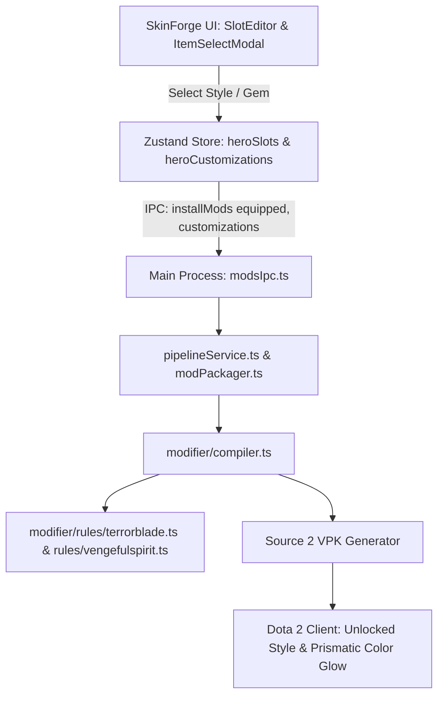

# Design Spec: Arcana Style Unlocking & Prismatic Gem Customization

## 1. Overview & Objectives

Dota 2 contains many high-tier cosmetics (particularly Arcanas) that have **alternative styles** (e.g. Vengeful Spirit Arcana's _Resurrection of Shen_, _Servants of Scree'Auk_, and _Queen Imperia_; Queen of Pain Arcana's _Royal Decree_; Wraith King's _Malignant Monster_) and **Prismatic Gem color sockets** (e.g. Terrorblade's _Fractal Horns of Inner Abysm_, Techies' _Swine of the Sunken Galley_).

Because SkinForge mods default items rather than modifying Game Coordinator (GC) inventory records, the Dota 2 Source 2 client defaults to Style 0 and base particle colors unless explicit unconditional overrides and particle control points are patched into `items_game.txt`.

This feature gives players full control in SkinForge to:

1. Select and unlock any alternate style for Arcanas that support them.
2. Select any authentic Dota 2 Prismatic Gem color (or custom RGB color) for Arcanas that support color socketing.
3. Automatically unroll style-conditioned asset modifiers, override models/skins, and inject particle control points into the generated VPK.

---

## 2. Architecture & Data Flow



### 2.1 State Structure

To ensure 100% backward compatibility with existing presets, unit tests, and string lookups:

- `heroSlots`: `Record<string, Record<string, string>>` remains untouched.
- `heroCustomizations`: `Record<string, Record<string, ItemCustomization>>` stores per-slot options.

```typescript
export interface ItemCustomization {
  style?: number // 0-indexed style (0 = Style 1, 1 = Style 2, 2 = Style 3 / Queen Imperia)
  gemColor?: string // Hex color code (e.g., '#D11FA1')
  gemName?: string // Authentic Valve Gem name (e.g., 'Rubiline')
}

export type HeroCustomizationsMap = Record<string, Record<string, ItemCustomization>>
```

---

## 3. Prismatic Gems & Arcana Metadata

### 3.1 Prismatic Gems Catalog (`src/shared/constants/prismaticGems.ts`)

A dedicated module containing all 42 official Valve Prismatic Gems extracted from `items_game.txt`:

- **Creator's Light** (`#DCF2FF`, RGB `220 242 255`)
- **Rubiline** (`#D11FA1`, RGB `209 31 161`)
- **Crystalline Blue** (`#1A3D85`, RGB `26 61 133`)
- **Midas Gold** (`#FFCA15`, RGB `255 202 21`)
- **Cursed Black** (`#060606`, RGB `6 6 6`)
- **Dungeon Doom** (`#7B68EE`, RGB `123 104 238`)
- **Ember Flame** (`#FFC604`, RGB `255 198 4`)
- **Blossom Red** (`#D76092`, RGB `215 96 146`)
- **Placid Blue** (`#94CAD0`, RGB `148 202 208`)
- **Bright Purple** (`#8232ED`, RGB `130 50 237`)
- **Reflection's Shade (Default TB Red)** (`#FF3C28`, RGB `255 60 40`)
- _(Full 42-color catalog with rarity tags and hex-to-RGB conversion helpers)_.

### 3.2 Arcana Styles Registry (`src/shared/constants/arcanaStyles.ts`)

A registry of all Dota 2 Arcanas with their supported styles and color gem capabilities:

- **Vengeful Spirit** (`The Resurrection of Shen - Wings`, ID `22718`):
  - Style 0: _Resurrection of Shen_ (skin: 0, model: `vengeful_spirit_arcana.vmdl`)
  - Style 1: _Servants of Scree'Auk_ (skin: 1, model: `vengeful_spirit_arcana.vmdl`)
  - Style 2: _Queen Imperia_ (skin: 0, model: `imperia.vmdl`, level: 3)
- **Queen of Pain** (`Eminence of Ristul`, ID `12930`):
  - Style 0: _The Eminence of Ristul_ (skin: 0)
  - Style 1: _Royal Decree_ (skin: 1)
- **Wraith King** (`Crown of the One True King`, ID `13456`):
  - Style 0: _The One True King_ (skin: 0)
  - Style 1: _Malignant Monster_ (skin: 1)
- **Windranger** (`Compass of the Rising Gale`, ID `13781`):
  - Style 0: _Compass of the Rising Gale_ (skin: 0)
  - Style 1: _Reflections of the Gale_ (skin: 1)
- **Phantom Assassin** (`Manifold Paradox`, ID `5963`):
  - Style 0: _Asan's Blade_
  - Style 1: _Elder Smith_
  - Style 2: _Nemesis Assassin_
- **Pudge** (`Feast of Abscession`, ID `7756`):
  - Style 0: _Feast of Abscession_ (Red)
  - Style 1: _Grand Abscession_ (Green)
- **Juggernaut** (`Bladeform Legacy`, ID `9059`):
  - Style 0: _Bladeform Legacy_
  - Style 1: _Origins_
- **Ogre Magi** (`Flockheart's Gamble`, ID `12975`):
  - Style 0: _Flockheart's Gamble_
  - Style 1: _Resplendent_
- **Razor** (`Voidstorm Asylum`, ID `22714`):
  - Style 0: _Voidstorm Asylum_
  - Style 1: _Storm Surged_
- **Faceless Void** (`Claszian Apostasy`, ID `22716`):
  - Style 0: _Claszian Apostasy_
  - Style 1: _Claszian Supremacy_
- **Drow Ranger** (`Dread Retribution`, ID `13787`):
  - Style 0: _Dread Retribution_
  - Style 1: _Master of Madness_
- **Earthshaker** (`Planetfall`, ID `12693`):
  - Style 0: _Planetfall_
  - Style 1: _Burning Descent_
- **Spectre** (`Phantom Advent`, ID `13788`):
  - Style 0: _Phantom Advent_
  - Style 1: _Volatile Elegance_
- **Rubick** (`The Magus Cypher`, ID `11974`):
  - Style 0: _Standard_
  - Style 1: _Golden Resplendence (40 Spells Unlocked)_
- **Skywrath Mage** (`The Devotions of Dragonus`, ID `22717`):
  - Style 0: _The Devotions of Dragonus_
  - Style 1: _Servants of Scree'Auk_
- **Terrorblade Arcana** (`Fractal Horns of Inner Abysm`, ID `5957` & `37161`):
  - Prismatic Gem Enabled: Full 42-palette + custom hex support.
- **Techies Arcana** (`Swine of the Sunken Galley`, ID `6487`):
  - Prismatic Gem Enabled.

---

## 4. UI Components

### 4.1 Item Selection Modal (`src/renderer/components/ItemSelectModal.tsx`)

When the active modal slot inspects an item with style or gem capabilities:

1. **Style Selection Pills**:
   - Renders a horizontal card/pill group for available styles.
   - Active style displays with vivid purple border, glow, and checkmark.
   - Clicking immediately sets the style on the item.
2. **Prismatic Gem Palette**:
   - For color-enabled items (e.g. Terrorblade), displays:
     - Preset swatches for popular official gems with tooltips and genuine colors.
     - A native `<input type="color">` and uppercase hex input for arbitrary RGB customization.
     - Active color preview orb with dynamic glow.

### 4.2 Slot Editor Grid Card (`src/renderer/components/SlotEditor.tsx`)

To allow instant changes without reopening the full item modal:

1. **Quick Style Dropdown**:
   - For equipped Arcanas with styles, displays a sleek pill under the item name:
     `[ 🎨 Style: Queen Imperia ▾ ]`
   - Fast inline dropdown to swap between available styles.
2. **Quick Gem Swatch Button**:
   - For equipped Terrorblade Arcana:
     `[ 💎 Rubiline (#D11FA1) ▾ ]`
   - Popover to switch gem colors instantly.

---

## 5. Modifier Compiler & Rules Engine

### 5.1 Style Flattening (`src/main/services/modifier/compiler.ts`)

When copying cosmetic item `visuals` block to the default item block:

1. **Modifier Filtering**:
   - Parse each `asset_modifier` inside `visuals`.
   - Modifiers with no `"style"` key are kept (common modifiers).
   - Modifiers where `"style"` equals the selected `styleIndex`:
     - Keep the modifier and **remove the `"style"` tag**, turning it into an unconditional modifier that the Source 2 client activates by default.
   - Modifiers where `"style"` differs from the selected `styleIndex` are dropped.
2. **Model & Skin Overrides**:
   - If the style definition has a custom model (e.g. `imperia.vmdl`), set the default item's `model_player` to that model.
   - Set `"model_skin"` with the chosen style's skin index.
   - Set `"arcana_level"` (`1`, `2`, or `3`).

### 5.2 Prismatic Gem Injection (`src/main/services/modifier/rules/terrorblade.ts`)

When Terrorblade Arcana is equipped with a `gemColor`:

1. Convert hex to decimal RGB vector: `#D11FA1` -> `"209 31 161"`.
2. Append `particle_control_point` modifiers for Control Point 15:
   ```vdf
   "asset_modifier"
   {
       "type"                  "particle_control_point"
       "asset"                 "particles/econ/items/terrorblade/terrorblade_horns_arcana/terrorblade_ambient_body_arcana_horns.vpcf"
       "control_point_number"  "15"
       "cp_position"           "209 31 161"
   }
   "asset_modifier"
   {
       "type"                  "particle_control_point"
       "asset"                 "particles/units/heroes/hero_terrorblade/terrorblade_feet_effects.vpcf"
       "control_point_number"  "15"
       "cp_position"           "209 31 161"
   }
   ```
3. Inject Control Point 16 vector (`"1.0 1.0 1.0"`).
4. Synchronize both `hero_base` (5957) and `ambient_effects` (540) so the horn flames, body flame, and foot fire trails all render in the selected Prismatic Gem hue.

---

## 6. Testing & Quality Assurance

1. **Unit Tests (`test/arcanaCustomization.test.js`)**:
   - Verify Vengeful Spirit Arcana Style 1 (_Servants of Scree'Auk_) unrolling: style tags stripped, skin 1 set, style 0/2 excluded.
   - Verify Vengeful Spirit Arcana Style 2 (_Queen Imperia_): model set to `imperia.vmdl`, level 3 set.
   - Verify Queen of Pain Arcana Style 1 (_Royal Decree_): skin 1 set, royal decree particles stripped of style tags.
   - Verify Terrorblade Arcana: CP 15 `cp_position` injected with exact RGB values for both horns and feet particles.
   - Verify backward compatibility: compiler with no customizations produces identical output to base compiler.
2. **Type Safety & Build**:
   - `npm run typecheck` passes with zero errors.
   - `npm test` passes all test suites.
